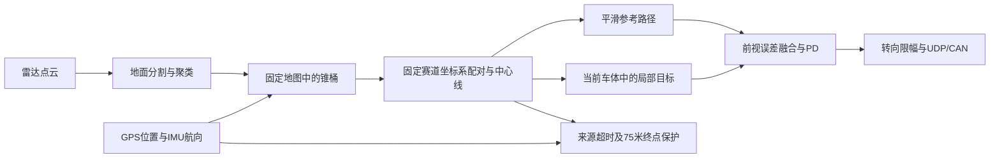

# 直线加速无人赛车算法 / Straight-line Acceleration

ROS 1 直线锥桶赛道的感知、GPS/IMU定位建图、中心线规划、前视目标PD转向与运行保护。

仓库：<https://github.com/subing509/straight-line-acceleration>。项目自有代码采用 [MIT](LICENSE)，第三方代码保留原许可，见 [第三方说明](THIRD_PARTY_NOTICES.md)。

## 算法



- 历史几何保存在固定地图/赛道系，控制器每周期投影到当前车体，避免复用旧车体系斜率。
- 左右锥桶配对距离2.5～3.8米，名义宽度3.15米；一组完整左右桶即可建立初始路径。
- 首次双排方向通过后冻结参考，后续允许方向角差约5.71°。
- 动态前视2.5～4米，路径与中心线目标融合，使用横向/航向PD；并非标准Pure Pursuit曲率公式。
- 有效道路依据超时、定位/IMU/路径超时或达到75米，触发停车锁存。

详细公式、参数与实现边界见 [核心算法说明](docs/ALGORITHMS.zh-CN.md)。

## 目录

| 目录 | 内容 |
|---|---|
| `src/acceleration_event` | 建图、主规划控制、独立实验雷达链、诊断与测试 |
| `src/mapping` | Cone/ConeArray等消息定义 |
| `src/imu` | 项目使用的串口GPS/IMU输入 |
| `src/lidar/src/lidar_nodes` | 点云预过滤、自适应DBSCAN、最新帧处理 |
| `src/lidar/src/linefit_ground_segmentation` | 第三方地面分割，BSD 3-Clause |
| `tests` | 输入完整性与感知时效等主机回归 |

本仓库是从工作区提取的源码快照，不包含八字项目、实车录包、GPS轨迹、远程连接脚本、备份、构建产物或现场原始日志。

## 环境与构建

历史目标环境为 Ubuntu 18.04、ROS Melodic、Python 2.7。主机离线测试使用Python 3，不代表节点可直接迁移到其他ROS/Python组合。硬件输入需要Velodyne驱动、匹配的串口设备与项目航向格式。

主要依赖：catkin、rospy、tf、标准ROS消息、NumPy、OpenCV、PyYAML、pyserial、ros_numpy、SciPy/scikit-learn、Velodyne；地面分割另需catkin_simple、glog_catkin及其依赖。先按目标ROS环境解决依赖，不复用其他机器的build/devel。

完整构建示例（Ubuntu终端，在新建独立工作区中进行）：

```bash
git clone https://github.com/subing509/straight-line-acceleration.git
cd straight-line-acceleration
source /opt/ros/melodic/setup.bash
# 如未安装地面分割的源码依赖，使用vcstool导入；需事先安装vcstool。
vcs import src < dependencies.repos
rosdep install --from-paths src --ignore-src -r -y
catkin_init_workspace src
catkin_make -j2 -DPYTHON_EXECUTABLE=/usr/bin/python2
source devel/setup.bash
rospack find acceleration_event
rosmsg show mapping/ConeArray
```

`dependencies.repos`跟随上游分支，首次成功构建后应自行冻结依赖提交；本次发布未在全新Ubuntu环境重做完整硬件依赖构建。只验证业务链时，可把 `mapping`、`acceleration_event` 复制到新的catkin工作区构建。

## 无车辆输出验证

```bash
# 已构建并source的独立ROS环境
roslaunch acceleration_event validation.launch synthetic_inputs:=true
```

该入口显式关闭车辆输出和可视化，提供合成输入；不要同时连接正式车辆ROS Master。标准主入口 `acceleration_event.launch` **默认启用车辆输出**。同名节点的私有参数必须正确加载，不能仅凭另一个匿名节点名下的参数断言输出已关闭。

仅在明确具备实车测试条件、已核对安装外参/转向符号/底盘协议后使用硬件链：

```bash
roslaunch lidar_nodes lidar.launch
rosrun imu daoyuan_simple.py
# 首次读取真实传感器，先保持输出关闭
roslaunch acceleration_event acceleration_event.launch enable_vehicle_output:=false
```

串口驱动将航向角（度）放在 `/imu_data.orientation.z`，不是标准四元数；不能直接替换为任意IMU驱动。CAN目的地址、雷达安装偏移和转向映射是原车配置，需要适配本车。

## 离线回归

```bash
python3 tools/run_offline_checks.py
```

入口只运行指定的无ROS/无底盘输出几何与保护测试；历史测试目录不是全部兼容当前配置，不能将选定回归通过写成“全目录全部通过”。真实ROS启动、实际轮角和车辆闭环仍需分别验证。

## 当前验证边界

源码快照包含方向门限和2.7～3.6米赛道适配修改。历史有一次调整前版本的约75米自主行驶记录；调整后曾通过暖机静态验证，随后重新开机仍出现有效锥桶检测间断、`road_stale`停车锁存。因此本仓库不宣称已完成新配置的动态赛道验收。

`running`只表示软件运行；UDP发送成功不表示VCU确认或轮角达到。停车锁存后数据恢复不自动重新驱动。软件转角限幅±0.50弧度不等于实际前轮机械角。

公开副本仅整理许可证、文档、构建安装规则和LF换行，不重新调参，也不修改原工作区或工控机。发布差异见 [发布说明](docs/RELEASE_NOTES.md)。
