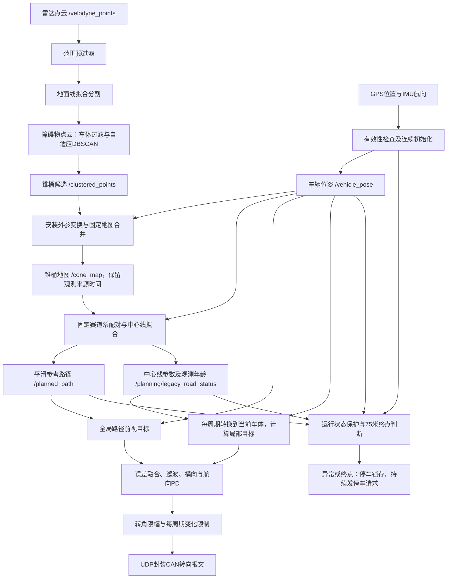

# 直线加速部分核心算法说明

算法快照：2026年10月23日；公开整理：2026年10月25日。

## 1. 整体逻辑与版本依据

这套程序用激光雷达寻找锥桶，用GPS提供位置、IMU提供航向，把不同时间看到的锥桶放进固定地图；再在固定赛道坐标系中配对左右锥桶、拟合中心线，生成一条平滑回归中心线的参考路径。控制器持续把中心线转换到当前车体坐标，结合路径前视目标，用横向与航向误差的PD控制产生转向指令。运行期间如果定位、IMU、路径或有效赛道依据超时，就锁存停车；沿启动时冻结的前进方向达到75米也请求停车。

“能持续发转角”和“能持续得到正确赛道偏差”是两件事。算法是否有效，要同时检查感知支持、定位坐标、目标误差、软件输出与底盘实际响应。

本说明对应仓库中的代码快照。主入口为 `acceleration_event.launch`，雷达另由 `lidar_nodes/lidar.launch` 启动；`acceleration_lidar.launch` 是独立实验链，验证结论不能混用。

## 2. 实际执行流程



其中“全局路径”是代码对 `/planned_path` 的称呼；它实际是不断重建的30米局部参考路径，并非预先录好的全场固定路线。保护逻辑与正常控制并行，锁存后优先执行停车分支。

## 3. 输入、感知与启动初始化

### 3.1 雷达如何变成锥桶候选

**输入：** Velodyne点云。**输出：** 雷达坐标下各聚类簇的质心 `PoseArray`。

1. 预过滤保留雷达坐标 `0<x<6米`、`−3<y<3米`、`z<0.8米` 的点。因此规划器允许前方25米候选，并不意味着单帧雷达实际看到了25米。
2. 地面分割使用径向分区、地面线拟合，将地面与障碍物分开，聚类读取 `/ground_segmentation/obstacle_cloud`。
3. 聚类前排除车体回波，避免把车身当成锥桶。
4. 在XY平面执行自适应DBSCAN：邻域半径由每点近邻距离估计，当前 `k=5`、`MinPts=5`；把密集点扩展为簇，噪点不作为簇输出。
5. 每簇取XYZ平均值作为候选位置。它是几何候选，不含颜色识别，也不能保证每簇一定是真锥桶。

当前还计算点数、高度、半径和距离相关的置信度，权重为点数0.6、距离0.4、高度及半径0。**但主输出 `PoseArray` 没携带此分数，`compute_clustering`也未按该分数筛掉簇。**不能把后续地图置信度直接当作这个雷达分类分数。

聚类使用“仅保留最新待处理帧”的工作线程，输入队列长度1，来源年龄默认上限0.4秒，输出仍保留来源时间。其目的在于避免积压旧帧；这能改善时效，却不能补回未检测到的锥桶。正常发布空数组表示本帧无候选，并不等于节点崩溃。

### 3.2 GPS和IMU分别做什么

GPS经纬度相对初始点转换为局部平面位置；IMU航向相对初始航向转换为车辆朝向。这里的“建图/SLAM”节点名不表示使用了完整激光SLAM优化：主位姿来自GPS与IMU，锥桶用于地图维护和赛道估计。

本项目串口驱动把**以度为单位的航向放在 `/imu_data.orientation.z`**，建图和控制保护按此约定读取；它不是标准四元数的z分量。建图发布的 `/vehicle_pose` 则使用四元数。对接其他IMU驱动时必须核对这一约定。

初始化需GPS、IMU均通过有效性与连续性检查，并持续满足约3秒等待，才冻结地图原点和初始航向。等待期间无效、过期或异常数据会重置初始化计时。车辆无需先行驶，也没有人工只读检查完成后才允许启动的程序门禁。

GPS检查包括经纬度范围、时间新鲜度、启动样本、跳变与速度合理性；IMU检查包括数据新鲜度及航向变化合理性。它们用于拒绝设备启动临时值和突变，不等同于高精度定位保证。

## 4. 三个坐标系与地图维护

| 坐标系 | 作用 | 是否随车头变化 |
|---|---|---|
| 固定地图M | 保存车辆位置和历史锥桶位置，原点为初始化GPS位置，方向按初始航向建立 | 否 |
| 固定赛道T | 用纵向s、横向d表达中心线、配对与方向参考 | 否，建立后固定；尚未成功建线的启动假设可重建 |
| 当前车体B | 表达目标相对车辆的前方距离与侧向偏差 | 是，每周期按当前位姿重新计算 |

雷达点先做Y符号调整、安装偏航旋转，再加安装平移，得到车体点；随后利用当时车辆位置和相对航向转入地图。当前安装平移约 `(1.76618,−0.11304)米`，偏航补偿0.5°，雷达Y符号为−1。

地图到车体的核心变换为：

```text
Δx = 目标地图x − 当前车辆地图x
Δy = 目标地图y − 当前车辆地图y
x_B =  cos(ψ)·Δx + sin(ψ)·Δy
y_B = −sin(ψ)·Δx + cos(ψ)·Δy
```

ψ为当前车辆在地图中的航向，单位弧度。代码把车体系定义为X前、Y右；物理左右与转向正负仍须用安装、航向和底盘协议联合验证，不能只凭变量名判断打舵方向。

历史锥桶按地图距离寻找最近对象，小于0.8米时合并，否则新建；超过6秒未更新的对象清除。地图保留历史有助于短时遮挡，但也可能留下错误关联或旧几何。

**地图保留6秒，不代表可以用旧赛道盲开6秒。**地图消息带最近有效非空检测的来源时间。空候选不会刷新它；反复发布地图、路径也不会把旧观测年龄清零。

当前采用的是整张地图层面的支持时间，而非对每个拟合锥桶分别核验最新观测。一次新检测可能让历史地图整体进入新一轮拟合，不能把“地图时间新鲜”理解为每个参与配对的桶都在本帧被重新看到。

## 5. 配对与中心线估计

### 5.1 左右锥桶如何配成一排

规划器在固定赛道系中处理几何，不依赖桶颜色，也不要求桶一定分布在当前车体左右符号两侧。首次用临时车头坐标配对，取首组两桶连线的法向，选择与车头前向一致的方向，建立固定赛道系。

随后在车辆附近筛选候选：纵向相对车辆−8～25米、横向距离不超过6米，最多20个。对任意两桶计算：

```text
纵向错位 dx = |s1−s2| ≤ 0.8米
两桶欧氏距离 w = sqrt((s1−s2)²+(d1−d2)²)，要求2.5≤w≤3.8米
中心点 = ((s1+s2)/2, (d1+d2)/2)
评分 = |w−3.15| + 0.35·dx + 0.01·|中心s−车辆s|
```

优先选评分低的组合，同一桶不得复用，两排中心的纵向间距至少1.5米，最多保留两排。名义宽度3.15米用于评分，不强制把赛道拟合为3.15米宽。

2.5～3.8米是配对欧氏距离，不能直接等同于纯横向赛道宽。实际宽3.6米且纵向错位0.8米时，欧氏距离约3.688米，仍能通过。旧范围2～4米本来已覆盖2.7～3.6米，此次宽度调整属于候选收紧，方向预算才是放宽。

### 5.2 中心点如何拟合方向

固定赛道系中的中心线为 `d=k·s+b`。两排及足够纵向跨度时，用最小二乘求原始斜率：

```text
k_raw = Σ[(s−平均s)(d−平均d)] / Σ[(s−平均s)²]
```

k是固定赛道系中的方向斜率，b为该系中s=0位置的截距。**b不是当前车辆横向误差**；误差还需要代入车辆位置并做坐标变换。

只有一排时保持原k，仅凭这一排更新位置；首次还没有历史方向时取k=0，即沿刚建立的赛道纵轴建线。这样允许车辆静止时凭一组完整左右桶起步，但单排对方向异常的辨别能力有限。

### 5.3 方向门限与平滑

两排能估计方向时才执行方向门限：

```text
|atan(k_raw)−atan(k_ref)| ≤ atan(0.10) ≈ 5.71°
```

首次没有参考时令比较参考为0；首次接受的双排方向保存为固定k_ref，后续始终与它比较，参考不会跟着累计偏差移动。因此后续限制是相对首次方向的角差，不是恒定要求 `|k_raw|≤0.10`。

超限时拒绝整次观测，不把错误斜率改造成虚假的横向截距。如果尚未形成有效中心线，会撤销临时赛道系以便重试；已经有效时保留上一条线，等待后续数据。

通过门限后，斜率变化先截断在±0.02，再乘0.12更新；截距取各中心点 `d−k·s` 的中位数，并限制单次位置变化；最后k、b还经过系数0.15的整体滤波。同一来源观测不会被10Hz定时器反复积分成多次新测量。

这些限制用于压制识别跳变，也会引入响应延迟。**当前车头转动不直接作为异常斜率**，因为检查的是固定T中的中心线；真实持续纠偏则在B系中进行。定位航向本身错误时，地图与投影仍可能出错。

## 6. 路径如何生成

规划器以10Hz生成前方30米路径，间距0.5米。设当前车辆在T中为 `(s_v,d_v)`，前向采样距离为u：

```text
赛道中心相对车辆的横向量 r(u) = k·(s_v+u)+b−d_v
r限制在±1.5米
α(u) = 0.5−0.5·cos(π·u/B)，0≤u<B；之后α=1
路径点T坐标 = (s_v+u, d_v+α(u)·r(u))
```

双排时过渡长度B=6米，单排时使用更缓和的12米。路径从车辆当前横向位置平滑接近中心线，再转换为地图点并做窗口平滑。这里的过渡沿固定赛道纵轴，不能据此保证起点切线与车头严格一致。

中心线更新失败后，已经启动的规划器可以继续发布保持路径，但道路支持年龄继续增加。路径消息新鲜与道路依据新鲜分别检查，避免用反复发旧路径掩盖感知失效。

启动文件中 `total_length=175米` 不等于当前终点距离，也不是当前局部路径长度；本实现实际生成窗口取 `local_path_length=30米`，停车终点取控制器的75米。

## 7. 转向控制：前视目标与PD

### 7.1 前视距离

实车速度来自位置差分估计，再限幅；不是直接使用程序设定速度作为实测车速。动态前视为：

```text
Ld = clip(2.5 + 0.35·v, 2.5, 4.0) 米
```

v单位米/秒：静止时2.5米；v=4.1667米/秒时约3.958米。前视是目标选取尺度，不是雷达感知距离。

路径目标从最近路径点起向前搜索最多20个点，选与Ld距离最接近且距离至少为0.8Ld的点，找不到时尝试未访问的远点。代码以路径索引和距离选点，并没有在此对每个候选强制检查车体x>0；路径异常时这一点也是需要检查的边界。

### 7.2 局部目标为什么能持续修正

控制器读取规划器发布的固定赛道中心线，支持年龄不超过0.35秒时，按**当前**车辆位姿调用 `body_line` 转为 `y_B=k_B·x_B+b_B`。局部目标取 `x_B=Ld`、`y_B=clip(k_B·Ld+b_B,−1,1)米`。

令车辆在T中为 `(s_v,d_v)`、车头相对T转角为Δψ，转换关系为：

```text
k_B = (k·cosΔψ−sinΔψ)/(cosΔψ+k·sinΔψ)
b_B = (k·s_v+b−d_v)/(cosΔψ+k·sinΔψ)
```

分母接近0时拒绝本次局部线投影。每周期重算可避免把“上一时刻车头朝向下的斜率”继续套到现在。控制器并非重新独立识别一条局部线；它与路径生成共享规划器的几何结果，不能视为两套独立感知冗余。

### 7.3 两种目标如何融合

分别对路径目标和局部中心线目标计算：

```text
e_y = 目标在当前车体中的y坐标（米）
e_ψ = wrap(目标方位角−当前车头方向)（弧度）
e = β·e_local+(1−β)·e_path
```

双排β=0.65，单排β=0.45；局部线超龄时仅用路径目标，但道路保护继续计时。这里e_y是**前视目标横向量**，e_ψ是**目标方位误差**，分别不等于车辆到真实赛道的垂距、中心线切线航向误差。

### 7.4 PD控制公式和输出限制

融合误差先执行一阶滤波：`e_f=0.88·e_f_previous+0.12·e`。再计算横向、航向PD：

```text
w = 0.35 + 0.65·clip(|e_y|/0.80,0,1)
δ_raw = steering_sign · [0.60·e_y + 0.05·clip(de_y/dt,−0.60,0.60)
                        +w·(0.20·e_ψ+0.01·clip(de_ψ/dt,−0.35,0.35))]
```

横向微分上限单位米/秒，航向微分上限单位弧度/秒。接近中心线时航向项减弱，避免与目标方位含有的横向信息重复放大。当前没有积分项，函数名虽为 `pid_control`，实际是PD。

输出δ先限制在±0.50弧度（约±28.65°），再限制每周期变化±0.012弧度（约0.688°）。20Hz正常周期下，后一限制相当于约13.75°/秒的软件指令变化速度；实际定时抖动时它不是严格按秒的限速。

**当前实现不是标准Pure Pursuit曲率控制。**它借用了前视选点，但没有使用 `曲率=2y/Ld²` 再通过轴距求转角的标准公式。也不能把±28.65°软件限幅直接当作实际车轮机械转角。

### 7.5 实车报文边界

正常指令通过UDP封装标准CAN帧0x210，角度单位弧度，编码近似 `raw=round(500+δ·1000/π)`；停车使用同帧特殊值raw=2000。正常零转角raw=500，二者不同。

当前实车链主要发送转向和停车请求；`fixed_speed=4.1667米/秒` 不能解释成已给底盘闭环下发并维持15km/h，油门控制另有仿真分支。UDP发送成功只证明本机调用发送成功，不证明VCU已收到、执行、车轮已达到指定角度或制动已完成。

## 8. 启动、等待、运行与停车锁存

| 阶段 | 判断与行为 |
|---|---|
| 等待 | 位姿、路径或保护输入尚未齐全，或输出开启但CAN客户端未就绪；继续等后续有效数据。运行保护此时不因缺数据新锁存停车 |
| 进入运行 | 有路径与位姿，输出条件满足，位姿/IMU/路径/道路来源均在有效时限内；不要求先移动 |
| 正常运行 | 约20Hz执行目标选择、误差融合和PD转向 |
| 锁存停车 | 已运行后来源超时、终点、控制异常、无前视目标或发送失败等触发；后续优先发停车请求 |

有效年龄采用“接收后经过时间＋消息到达时已有的来源年龄”，不是简单看话题是否持续发布。超时预算：位姿0.8秒、IMU0.8秒、路径1.0秒、道路支持1.0秒。

三个容易混淆的道路时间：

- 0.35秒：控制器允许局部线参与误差融合的支持年龄。
- 0.50秒：规划器允许地图进入新拟合的观测年龄。
- 1.00秒：运行保护允许的道路支持年龄；超过就可能锁存 `road_stale`。

规划器中超过3秒的警告是日志提醒，不是主停车触发器，实际控制器可能更早在1秒触发。

75米按启动时冻结的方向轴计算净进度：`p=(x−x_start)·cosθ+(y−y_start)·sinθ`。θ优先取启动时赛道方向，之后不随车头或新拟合旋转。这不是累计轨迹长度，不会把原地抖动反复累加为路程。达到75米锁存 `finish`；软件触发位置不等于车辆最终物理停住的位置。

锁存记录第一个停车原因，数据恢复不会自动解除；当前实现需控制器重新初始化后再满足条件，且应先查明触发原因。`started=true`只表明曾进入运行，需结合 `state`、`stop_reason` 判断现在是否已停止。

## 9. 关键参数与代码定位

以下取主启动文件显式值，优先于源码默认值。系数为算法增益或无量纲比例时不标机械单位。

| 环节 | 参数/当前值 | 实际用途 |
|---|---|---|
| 预过滤 | x 0～6m，y −3～3m，z<0.8m | 单帧有效空间，边界为严格不等式 |
| 聚类 | K_NEIGHBORS=5，MIN_PTS=5；max_frame_age默认0.4s | 密度聚类及来源时效 |
| 初始化 | imu_init_wait_time=3s；GPS max_age=0.5s | 有效输入后初始化等待及GPS新鲜度 |
| 地图 | merge_distance=0.8m；cone_timeout=6s | 历史锥桶合并和保留 |
| 配对 | 名义3.15m；距离2.5～3.8m；纵向错位≤0.8m | 两桶组合评分与有效性 |
| 候选 | 纵向−8～25m；最多20桶、2排；排间≥1.5m | 固定T中筛选 |
| 方向 | straight_slope_limit=0.10 | 角差atan(0.10)，约5.71° |
| 滤波 | max_slope_change=0.02，slope_alpha=0.12，centerline_alpha=0.15 | 方向与中心线平滑 |
| 路径 | 长30m、间隔0.5m、双排过渡6m/单排12m、偏移限1.5m | 生成平滑返回路径 |
| 周期 | 规划10Hz，控制约20Hz | 规划与控制更新 |
| 前视 | 2.5～4.0m，速度系数0.35s | 目标选取 |
| 融合 | 双排0.65，单排0.45；局部支持0.35s | 局部线与参考路径误差权重 |
| PD | 横向Kp=0.60/Kd=0.05；航向Kp=0.20/Kd=0.01 | 转角计算 |
| 输出 | sign=1；最大0.50rad；每周期变化0.012rad | 软件方向、幅值与变化限制 |
| 保护 | pose/imu 0.8s，path/road 1.0s | 运行失效停车 |
| 终点 | finish_distance=75m | 固定轴净进度触发 |

定位索引：

- [主启动文件与参数](../src/acceleration_event/launch/acceleration_event.launch)
- [点云预过滤](../src/lidar/src/lidar_nodes/src/input_and_prefilter.py)
- [聚类计算与发布](../src/lidar/src/lidar_nodes/src/clustering.py)
- [地面分割入口](../src/lidar/src/linefit_ground_segmentation/linefit_ground_segmentation_ros/launch/segmentation.launch)
- [建图初始化](../src/acceleration_event/src/jiantu.py)
- [观测时间与地图更新](../src/acceleration_event/src/jiantu.py)
- [固定赛道配对与车体线变换](../src/acceleration_event/src/track_frame.py)
- [方向门限与中心线滤波](../src/acceleration_event/src/zhixian_realtime.py)
- [路径生成](../src/acceleration_event/src/zhixian_realtime.py)
- [前视与局部线转换](../src/acceleration_event/src/genzong_realtime.py)
- [PD控制](../src/acceleration_event/src/genzong_realtime.py)
- [终点和保护主循环](../src/acceleration_event/src/genzong_realtime.py)
- [来源超时与锁存](../src/acceleration_event/src/legacy_run_guard.py)

注意保留代码：控制器的 `_pair_candidates` 及部分 `local_cone_*`、`pair_max_dx`、`local_max_slope` 参数不应被描述为当前控制主循环重新配对、重新拒绝方向的门限；当前局部线来自 `fixed_road`。规划器也保留了一些旧参数，实际候选范围应以 `paired_centers` 为准，而非按 `local_max_x` 字面解释。


## 10. 验证边界

该实现面向近似直线双侧锥桶赛道。几何回归通过不等于真实车辆稳定性通过；实际轮角映射、执行延迟、感知连续性和定位误差需要各自验证。多级平滑可能造成响应延迟；地图整体新鲜度也不等于每个历史锥桶都在当前帧重新观测。
